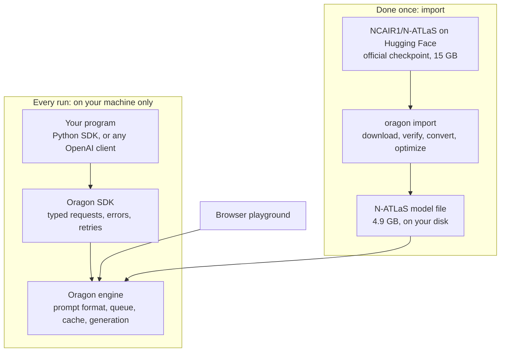

# Architecture

How N-ATLaS gets from NCAIR's published checkpoint to an answer in your
program, and what each part is responsible for.

## The parts

| Part | What it does |
|---|---|
| **N-ATLaS checkpoint** | The model as NCAIR publishes it: weights, tokenizer and chat template. We do not modify or redistribute it; each user downloads it under NCAIR's terms. |
| **`oragon import`** | Downloads the checkpoint, checks every weight file against its published checksum, converts it to the engine's single-file format and reduces it from 16-bit to roughly 4-bit precision so it fits and runs on a processor. |
| **Model file** | One 4.9 GB file holding the weights, the tokenizer and N-ATLaS's own chat template. |
| **Oragon engine** | A native program installed with the Python package. It loads the model once, keeps it in memory, and generates text. It runs on the processor, or on a GPU when one is present. |
| **Oragon SDK** | The Python package your code imports. It starts and stops the engine, sends requests, and turns failures into typed exceptions. |
| **OpenAI-compatible server** | `oragon serve` puts the same engine behind an HTTP API in the OpenAI format, plus a browser playground, so programs in any language can use N-ATLaS. |

## What happens to one question

1. **Your program** calls `client.chat.generate(...)` with a system prompt and
   a user message.
2. **The SDK** sends the request to the engine. On the first request it
   starts the engine and the engine loads the model, which takes 10 to 17
   seconds once.
3. **The engine builds the prompt** by running the chat template stored
   inside the model file. For N-ATLaS that produces the start-of-text token,
   a knowledge-cutoff line, today's date, the system prompt and the user
   message, each wrapped in the markers the model was trained with. This is
   the same prompt NCAIR's reference code produces.
4. **The engine generates** the answer a token at a time. With streaming on,
   each piece is sent back as it is produced.
5. **The SDK returns** the answer with token counts and timings.

Step 3 matters more than it looks. A model given a prompt in a different
format from the one it was trained on still loads and still answers fluently,
so nothing warns you. For N-ATLaS the engine takes the format from the model
itself, and `oragon template N-ATLaS` prints the exact prompt so it can be
compared with NCAIR's. Our check, and a script that
repeats it, are in [the evidence](../evidence/README.md).

## Why it runs without a GPU

- **Smaller numbers.** The published weights use 16 bits per value. The
  imported file uses about 4, which cuts the model from 15 GB to 4.9 GB with
  little change in the answers. We compared three precision levels on the
  same question and saw no difference in quality
  ([details](../evidence/README.md#does-the-smaller-file-cost-quality)).
- **The model stays loaded.** Loading happens once per run, not once per
  request.
- **Shared prompts are read once.** A system prompt that every request
  starts with is processed a single time and reused, which is why the first
  word arrives in well under a second.
- **Requests run side by side.** Up to four requests are generated at the
  same time and batched together; more wait in a queue.

## Where your data goes

Nowhere. Prompts and answers stay in the engine's memory on your machine.
The SDK sends no telemetry, crash reports or update checks. The only network
traffic is the model download during import, which you can forbid afterwards
with `ORAGON_AUTO_DOWNLOAD=0`. A machine with the model file on disk can run
N-ATLaS with no connection at all.

## What Oragon does specifically for N-ATLaS

1. **Imports the official checkpoint in one command.** `oragon import
   NCAIR1/N-ATLaS` handles the gated download, the checksums, the conversion
   and the size reduction, and prints the name to load the result by.
2. **Runs N-ATLaS's own chat template.** The start-of-text token, the
   knowledge-cutoff line and today's date are written exactly as the
   template says. `oragon template N-ATLaS` shows the result.
3. **Serves it on a processor.** The defaults are chosen so that a machine
   with no GPU gives a usable speed without any tuning.
